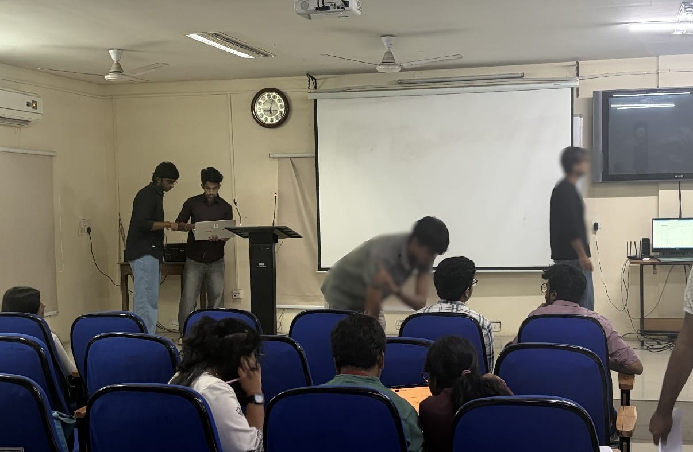
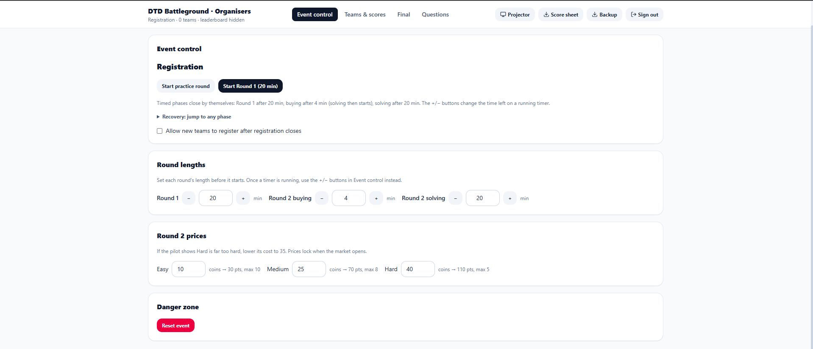
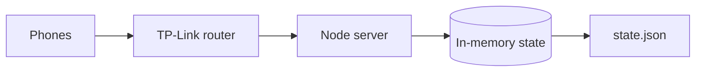

# DTD Battleground

A live three-round team quiz platform, built for the Data Science Club, JNTUH.
Ran on Oct 26, 2026: 13 teams, 39 participants, on a local router network.



*The event hall: projector, TP-Link router on the desk (right), teams on their phones.*

> Real question bank is not included (see `server/questions.sample.json`).



## At a glance
- Node.js (built-in `http`), React + Vite, in-memory state saved to `state.json`
- Rounds: timed MCQ/numeric, coin-based buying, buzzer final
- Server-authoritative time, answers and standings
- Load-tested with k6 (localhost, direction only)

## Architecture

More: [architecture](docs/architecture.md)

## Key decisions
- Async hashing and backpressure
- Group commit: reply only after the change is saved
- Polling instead of WebSockets
- Local server instead of Vercel
- Leaderboard hidden until admin publishes  
Details: [decisions](docs/decisions.md) ([PDF](docs/DTD%20Battleground_%20Decisions%20and%20Trade-offs.pdf)) · [design change log](docs/design-change-log.md)

## Results and what went wrong
[load-testing](docs/load-testing.md) · [event report](docs/event-report.md) · [security review](docs/security-review.md)

## Contributors
| Person | Contribution |
|---|---|
| Ganesh | Initial prototype |
| Chiranjeevi | Built the platform from my requirements (admin console, participant app), AI-assisted with Claude. Implemented the leaderboard release control and the larger sign-in queue. |
| Revanth | Ran the server from his laptop on event day |
| Shivashanker | Wrote the requirements and game rules, made the architecture and trade-off decisions, ran the load tests and security review, hosted the event |
| Abhinav | Shortlisted questions for final quiz question bank |

Much of the code was written with AI assistance (Claude, and Codex for implementation and review). My part was the requirements, design decisions, review and testing, and I can explain the design choices in this repo.

## Run locally

### 1. Prerequisites
- **Node.js**: v20 or higher (`node -v`)
- **npm**: v10 or higher (`npm -v`)

### 2. Install dependencies
```bash
npm install
```

### 3. Verify question bank
Validates `server/questions.json` (or checks against the fallback `server/questions.sample.json`):
```bash
npm run check-questions
```

### 4. Build frontend
Build the React single-page application into `dist/`:
```bash
npm run build
```

### 5. Start the server
Set an optional admin password (if omitted, a one-time random password is printed to the console on startup) and start the server:

**Linux / macOS (Bash):**
```bash
export ADMIN_PASSWORD="your_admin_password"
node server/index.js
# or: npm start
```

**Windows (PowerShell):**
```powershell
$env:ADMIN_PASSWORD="your_admin_password"
node server/index.js
# or: npm start
```

### 6. Access the views
- **Team view (Participants):** [http://localhost:3001/](http://localhost:3001/)
- **Admin dashboard (Organizers):** [http://localhost:3001/#/admin](http://localhost:3001/#/admin)
- **Projector screen (Audience):** [http://localhost:3001/#/display](http://localhost:3001/#/display)

### Development mode
Run the Vite development server with hot-reload alongside the backend:
```bash
npm run dev      # Vite dev server on port 5173
npm run server   # Node backend with auto-reload (--watch) on port 3001
```

### Run tests
```bash
npm test
```

## Status
v0.1 shipped. v0.2 proposed: [roadmap](docs/roadmap.md)
