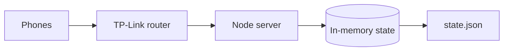

# DTD Battleground

A live three-round team quiz platform, built for the Data Science Club, JNTUH.  
Ran on Oct 26, 2026: 13 teams (plus one internal test team), 39 participants, on a local router network.


*The event hall: projector, TP-Link router on the desk (right), teams on their phones.*

## Highlights
- **Ran live:** 13 teams (plus one internal test team), 39 participants, 3 rounds, about 70 minutes, no website problems.
- **Load-tested:** 1000 simulated pollers, p95 1.92 ms, 0% errors (localhost, one laptop).
- **Found and fixed a blocking bug:** polls took seconds during a registration burst. Async hashing and batched writes cut poll p95 from about 4–12 s to under 1 s in my runs.
- **Security review:** an admin-auth bypass (`Bearer constructor`) and a standings leak, both fixed with tests.
- **Honest limits:** no `fsync`, one process, no fairness check on the buzzer yet. See [roadmap](docs/roadmap.md).

> Real question bank is not included (see `server/questions.sample.json`).


*Admin dashboard: phase controls, live timer extension, question preview, and audit log.*

## At a glance
- Node.js (built-in `http`), React + Vite, in-memory state saved to `state.json`
- Rounds: timed MCQ/numeric, coin-based buying, buzzer final
- Server-authoritative time, answers and standings
- Load-tested with k6 (localhost, direction only)

## Architecture


<details>
<summary>Text diagram (Mermaid)</summary>


</details>

More: [architecture](docs/architecture.md)

## Key decisions & results
- **Async hashing:** cut registration burst poll p95 from 4–12 s to ~0.79 s
- **Group commit:** reply only after the change is written and renamed (survives a process crash; no fsync)
- **Polling over WebSockets:** simple client reconnection and watchdog on venue Wi-Fi without server connection tracking
- **Local server instead of Vercel:** single-process in-memory state, zero cloud cost, works completely offline
- **Leaderboard hidden until admin publishes:** prevents qualification ranking spoilers before Round 3  
Details: [decisions](docs/decisions.md) ([PDF](docs/DTD-Tradeoff-Decisions.pdf)) · [design change log](docs/design-change-log.md)

## Results & what went wrong
- **Load testing:** simulated 1000 concurrent pollers with sub-3 ms latency; stress-tested registration burst with 256-slot queue.
- **Version drift on event day:** I committed 20-minute rounds before the event, but a teammate's local copy still had 30 minutes. Under stage pressure when my laptop had startup trouble, we ran from his un-synced copy.
- **What I'd change:** deploy strictly from a git tag, provide a single start script, rehearse directly on the event laptop, and display the active commit hash and round lengths on the admin console.  
Full reports: [load-testing](docs/load-testing.md) · [event report](docs/event-report.md) · [security review](docs/security-review.md)

## Contributors
| Person | Contribution |
|---|---|
| Ganesh | Initial prototype |
| Chiranjeevi | Built the platform from my requirements (admin console, participant app), AI-assisted with Claude. Implemented the leaderboard release control and the larger sign-in queue. Co-hosted the event. |
| Revanth | Ran the server from his laptop on event day, co-hosted the event, added client-side anti-copy protection (`select-none` on questions and code) |
| Shivashanker | Wrote the requirements and game rules, made the architecture and trade-off decisions, re-ran and interpreted the load tests, reviewed the code for security issues, co-hosted the event |
| Abhinav | Shortlisted questions for final quiz question bank |

Much of the code was written with AI assistance (Claude, and Codex for implementation and review). My part was the requirements, design decisions, review and testing, and I can explain the design choices in this repo.

<details>
<summary><b>Run locally (Prerequisites, setup, and dev mode)</b></summary>

### 1. Prerequisites
- **Node.js**: v20 or higher (`node -v`)
- **npm**: v10 or higher (`npm -v`)

### 2. Install dependencies
```bash
npm install
```

### 3. Verify question bank
Validates `server/questions.json` (or checks against the fallback `server/questions.sample.json`):
```bash
npm run check-questions
```

### 4. Build frontend
Build the React single-page application into `dist/`:
```bash
npm run build
```

### 5. Start the server
Set an optional admin password (if omitted, a one-time random password is printed to the console on startup) and start the server:

**Linux / macOS (Bash):**
```bash
export ADMIN_PASSWORD="your_admin_password"
node server/index.js
# or: npm start
```

**Windows (PowerShell):**
```powershell
$env:ADMIN_PASSWORD="your_admin_password"
node server/index.js
# or: npm start
```

### 6. Access the views
- **Team view (Participants):** [http://localhost:3001/](http://localhost:3001/)
- **Admin dashboard (Organizers):** [http://localhost:3001/#/admin](http://localhost:3001/#/admin)
- **Projector screen (Audience):** [http://localhost:3001/#/display](http://localhost:3001/#/display)

### Development mode
Run the Vite development server with hot-reload alongside the backend:
```bash
npm run dev      # Vite dev server on port 5173
npm run server   # Node backend with auto-reload (--watch) on port 3001
```

### Run tests
```bash
npm test
```

</details>

## Status
v0.1 shipped. v0.2 proposed: [roadmap](docs/roadmap.md)
