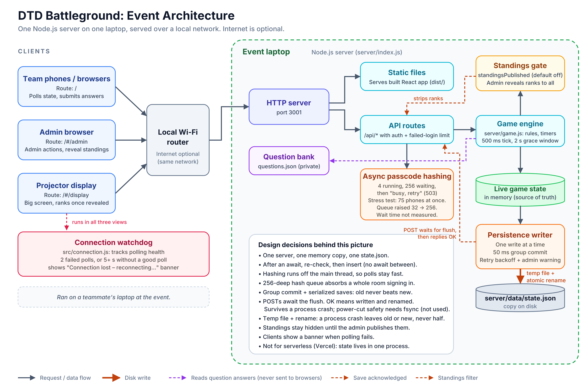

# Architecture

## Components
- **Clients:** team app (`/`), admin console (`/#/admin`), projector (`/#/display`), one React app, screen chosen by URL hash.
- **Server:** one Node.js process, built-in `http`, port 3001. Serves the built React app and `/api/*`.
- **Game engine:** `server/game.js`, pure functions over (state, questions, now), unit-tested.
- **State:** one in-memory object is the source of truth; `server/data/state.json` is a copy.
- **Question bank:** private JSON, answers never sent to browsers. `questions.sample.json` is included.

## Request flow
Phones poll `GET /api/state` about every 1.5 s. Actions are POSTs. The server owns the clock and clients render countdowns from `serverNow`.

## Persistence
Dirty flag, one writer, 50 ms group commit, temp file + atomic rename. POST replies wait for the write containing their change.
**Limit:** no `fsync`, so a power cut can still lose the latest write. Group commit protects against process crash, not power loss.

## Concurrency rule
Node switches requests only at `await`. After hashing, the code re-checks the team name and inserts with no `await` in between.

## Security boundaries
Separate team and admin sessions, scrypt hashes, failed-login rate limit, standings gate enforced in the API.

## Known limits
Single process, no corrupt-state fallback, no team cap, no registration rate limit, plain HTTP. See [roadmap](roadmap.md).