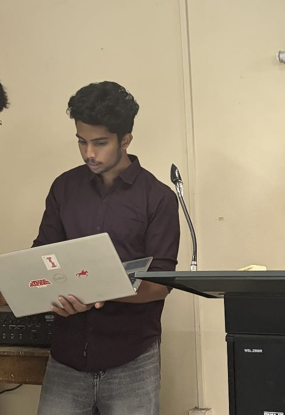

# Event report: Oct 26, 2026

## Facts
- 13 teams, 39 participants, TP-Link router (from the HOD), server on a teammate's laptop.
- [FILL: number of devices, venue]
- Planned 5:00 pm, started about 5:30 (late joiners, first club event of the year), finished 6:40 pm.
- No website problems. Admin dashboard screenshots taken during the event.

*Hosting the event from the podium, Oct 26, 2026.*

## Rounds
- **Round 1:** configured 30 min on the server laptop. Teams finished in about 20 min, so I closed it from the admin console.
- **Round 2:** same, about 20 min.
- **Round 3:** top 8 teams, 10 questions, about 1 min each, buzzer console. First buzzer +50. If wrong, the second-fastest team gets a rebound for +35 with the first team's wrong option removed.

## What went wrong
- **Version drift:** I had committed 20-minute rounds, but a teammate's local copy still had 30. Under stage pressure I ran wrong commands and my laptop would not start the server, so we ran from his copy. The exact commit was not recorded.
- Late start and rushed host coordination. Timers were slightly generous.

## Open
- **Buzzer fairness:** three teams won most buzzes. Cause not checked (poll-gating, network position, server ordering, or skill). Logs are [FILL: available or not].

## What I'd change
Deploy from a tag, one start script, show commit hash and round lengths on the admin screen, rehearse on the event laptop, add a runbook.

## What worked
Rehearsal (Oct 23-24) found that deliberate restarts recovered cleanly. Admin phase control let me close rounds live.